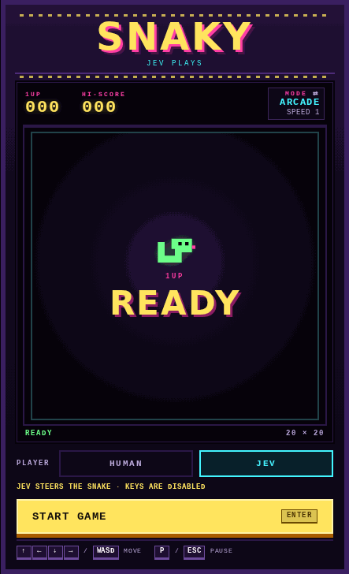

# Snaky, an arcade game played ay an AI

Demo of Jev playing a snake game:



A small, dependency-free Snake game styled as a 1990s arcade cabinet. It has a pixel board, solid walls, focused keyboard controls, a best score saved in the current browser, and two speeds of play: Arcade starts slower and accelerates, while Classic stays fixed.

## Run locally

Use Node.js 22 or newer. From this directory:

```sh
npm ci
npm run dev
```

Open the printed URL, normally `http://127.0.0.1:4173`. No runtime packages or API keys are required to play as a human. If that port is busy, use `PORT=4174 npm run dev`. The server listens on `127.0.0.1` by default; set `HOST=0.0.0.0` to reach it from other devices.

## Verify and build

```sh
npm test
npm run build
npm run preview
```

`npm test` runs deterministic rules, timer/lifecycle, storage, and build tests. `npm run build` creates `dist/index.html`, a self-contained release with embedded CSS, JavaScript, and favicon. Serve `dist/` with any static HTTP server; it needs no backend, account, remote font, or asset service. It also opens directly from disk in ordinary browsers, though best-score persistence on file URLs varies by browser. Use a consistent HTTP origin for a reliable saved Best.

For the browser integration suite, open `http://127.0.0.1:4173/qa/browser.html` after starting production preview. It runs the production code and interface inside an iframe with controlled time/randomness and reports each result. It checks Arcade/Classic timing and mode switching, Start/play/pause/resume/collision/restart, completion, focus, scrolling-key interception, visibility/window-focus pauses, best-score behavior, canvas rendering, 360/768/1440 layouts, and no-scroll fit at 1440×900, 1366×768, and 360×640. The fixture is isolated from an ordinary live game.

In development, the source QA page is also available at `/test/browser.html`.

## Let Jev play

The **PLAYER** selector under the board switches between **Human** and **Jev**, TypeSafe AI's decision model. It can be changed whenever the game is not running.

Jev needs an API key from the TypeSafe console. The browser never sees it: the dev and preview servers expose a small `/api/jev` proxy that reads the key from the environment.

```sh
JEV_API_KEY=your-key npm run dev
```

- Before each move, the game sends Jev the board (head, body, food, direction) plus a per-move summary: whether each move is legal and safe, how many cells stay reachable after it, and the distance to the food. Jev answers with one of `up`, `right`, `down`, `left` through a `choice` question on `POST https://api.typesafe.ai/v1/systemone`.
- The decision is requested as soon as the previous move lands, so it overlaps the tick delay. If Jev is slower than the tick, the snake waits for it.
- When only one safe move exists the game plays it without calling Jev.
- Arrow keys and WASD are ignored while Jev plays; **P** and **Escape** still pause.
- If a request fails (no key, network, API error, unusable answer) the game pauses and says why. Choose Resume to retry.
- Jev runs never change the saved human Best.
- The proxy forces the model to `jev-latest`, rejects bodies over 64 KB and only accepts POST. Set `JEV_API_URL` to point it at a different endpoint, for example a local mock.
- Static servers such as `python3 -m http.server`, and a copy of `dist/` opened from disk, have no proxy. Jev mode pauses with "No Jev proxy on this server". Serve it with `npm run preview` instead.

## Play

- The cabinet scales to the viewport so the whole machine stays visible on short desktop and mobile screens.
- Choose **Start game**, press **Enter**, or press **Space**. The board receives keyboard focus.
- **Arcade** is selected by default. It starts at one move every 200 ms, then gets 10 ms faster for every 5 bites, down to an 80 ms floor. **Classic** stays at one move every 125 ms.
- Click the **MODE** readout in the HUD to switch between Arcade and Classic. Switching modes starts a fresh ready run; the current mode and speed stay visible in the same readout.
- Steer with **arrow keys** or **WASD**. Only the first legal turn before a tick is accepted. You cannot reverse into yourself.
- **P** pauses or resumes when the board has focus. **Escape** pauses. From paused or finished, **Enter** or **Space** resumes or restarts; the main action button does the same.
- **Tab** leaves the board normally. Direction keys are intercepted only in the focused running board; browser shortcuts remain usable.
- Moving focus off the board (Tab, or clicking elsewhere), switching away from the browser, or hiding the tab pauses the game. Choose Resume explicitly when you return.
- Eat food for one extra segment and **10 points**. Hitting a wall or your body ends the run; filling the entire board wins.
- Restart from paused or finished starts a fresh run. Best is retained for the same browser/site. Storage failure keeps the game playable and tracks Best for the open page.

## Gameplay defaults and scope

Both modes use a fixed 20 × 20 grid, head at (10,10), body at (9,10)/(8,10), heading right, score 0, one food item, +10 points per bite, and 400 cells. Classic keeps the original fixed 125 ms tick (8 moves/second). Arcade is the default: it starts at 200 ms (5 moves/second), tightens by 10 ms every 5 bites, and stops accelerating at 80 ms. Speed does not change scoring, so the maximum score remains 3970 in both modes. Entering the vacating tail is legal; invalid moves preserve the last valid board. Filling 400 cells stops without spawning food.

This release contains the implementation for MKT-20–25, the optional local Best feature MKT-27, and the Arcade/Classic mode follow-up; browser release verification is tracked separately in `VERIFICATION.md`. MKT-26 touch controls remain a separate optional follow-up; keyboard play is the supported input. There are no accounts, online leaderboards, multiplayer, audio, obstacles, or power-ups. The only server code is the optional Jev proxy in the dev/preview server.

## Source layout

- `src/engine.js`: pure rules, mode timing, and direction mapping.
- `src/controller.js`: one repeating simulation timer using the current mode's delay, with explicit lifecycle and an optional async decider (Jev).
- `src/jev.js`: builds the Jev request from a game state, parses its answer, and wraps the proxy call.
- `src/storage.js`: resilient local Best storage.
- `src/app.js`: DOM input, lifecycle events, focus and overlay copy.
- `src/renderer.js`: crisp Canvas board rendering, independent of game rules.
- `test/`: deterministic Node tests and the browser integration suite.
- `scripts/`: dependency-free development server and static build.

The build embeds the fixed local module graph without adding a bundler dependency. The browser suite uses the same source modules and production HTML/CSS. `.openai/hosting.json` retains the private Site identity for future publication; it contains no credential.

See [VERIFICATION.md](VERIFICATION.md) for the current release evidence and any remaining browser or hosting limitations.
